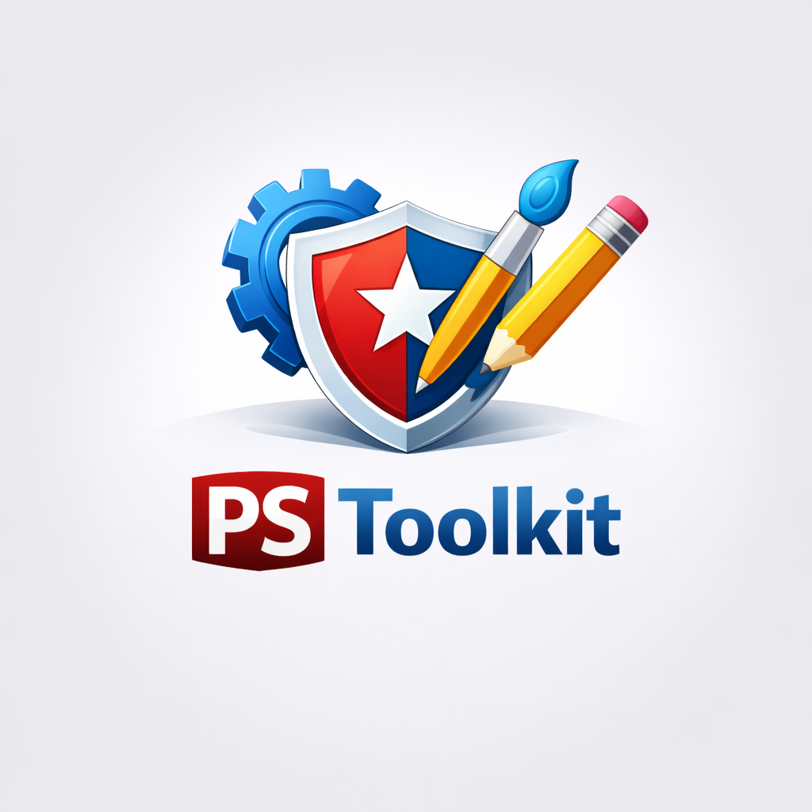

<div align="center">



# PSOURCE Toolkit

**Deine Marke. Dein Dashboard. Dein ClassicPress.**

White-Label- und Branding-Toolkit für Anmeldeseiten, Administration, E-Mails und Multisite-Netzwerke.

</div>

**Deutsch** | [English](README.en.md)

[](readme.txt)


[](https://www.gnu.org/licenses/gpl-2.0.html)

---

## Ein Auftritt, der zu Dir passt

Vom ersten Login bis zur System-E-Mail: PSOURCE Toolkit hilft Dir, eine konsistente Oberfläche für Deine Webseite oder Dein Netzwerk zu gestalten. Passe Logos, Farben, Menüs und Inhalte an, ohne dafür die Core-Dateien Deiner Installation zu verändern.

Das Plugin richtet sich an Webseitenbetreiber, Agenturen und Multisite-Administratoren, die ihren Nutzern eine individuell gestaltete Verwaltungsoberfläche anbieten möchten.

> Im Dashboard findest Du das Plugin unter **CP Toolkit**. Im Quellcode begegnen Dir außerdem die Bezeichnungen `PSToolkit` und `psource-branding`.

## Funktionen

Das Toolkit bündelt mehr als 30 Module. Welche Optionen verfügbar sind, hängt unter anderem vom Installationstyp und den vergebenen Berechtigungen ab.

| Bereich | Möglichkeiten |
| --- | --- |
| **Login & Registrierung** | Anmeldebildschirm gestalten, Bilder und Farben anpassen sowie Registrierungsfunktionen konfigurieren. |
| **Admin-Bereich** | Admin-Leiste, Menüs, Fußzeile, Farbschemata, Hilfeinhalte und eigene CSS-Regeln anpassen. |
| **Dashboard & Widgets** | Dashboard-Widgets konfigurieren, eigene Feeds einbinden und das Meta-Widget an das Branding anpassen. |
| **E-Mails** | Absenderangaben und HTML-Vorlagen gestalten, SMTP einrichten und E-Mail-Protokolle nutzen. |
| **Frontend** | Header- und Fußzeileninhalte, Cookie-Hinweis, Autorenbox und Statusseiten konfigurieren. |
| **Wartung & Werkzeuge** | Wartungs- und Coming-soon-Modus, Textersetzung, Kommentarsteuerung und Tracking-Codes verwalten. |
| **Multisite & Einstellungen** | Netzwerkvorgaben und Überschreibungsrechte steuern sowie Konfigurationen importieren und exportieren. |

Die vollständige Moduldefinition findest Du in [`etc/config.php`](./etc/config.php).

## Voraussetzungen

- **PHP 8.0 oder neuer**
- Eine **ClassicPress- oder WordPress-Installation**
- Administrative Berechtigungen; für netzwerkweite Einstellungen entsprechende Multisite-Rechte

Die Plugin-Metadaten nennen WordPress **4.6** als Mindestversion und **6.8.1** als zuletzt getestete Version. Diese Angaben sind keine Bestätigung, dass jede Kombination aus CMS-, PHP- und Drittanbieter-Version getestet wurde. Prüfe Updates zunächst in einer Staging-Umgebung.

**Node.js und npm sind nur für Entwicklung und Tests erforderlich**, nicht für den normalen Plugin-Betrieb.

## Installation

1. Lade ein passendes Paket aus den [Releases](https://github.com/Power-Source/psource-branding/releases) herunter oder kopiere den Repository-Inhalt in:

   ```text
   wp-content/plugins/psource-branding/
   ```

2. Aktiviere **PSOURCE Toolkit** in der Plugin-Verwaltung.
3. Aktiviere das Plugin bei Bedarf netzwerkweit für Deine Multisite-Installation.
4. Öffne **CP Toolkit** und richte die gewünschten Module ein.

Die für den Betrieb eingebundenen JavaScript-Bibliotheken liegen im Repository. Auf dem Webserver ist dafür kein `npm install` notwendig.

### Dein erster Branding-Durchlauf

1. **Sichern:** Erstelle ein Backup und arbeite nach Möglichkeit zunächst auf einer Testinstallation.
2. **Gestalten:** Beginne mit Anmeldeseite, Logo, Farbschema und Admin-Fußzeile.
3. **Strukturieren:** Passe Admin-Menüs und Dashboard-Inhalte an die Aufgaben Deiner Nutzer an.
4. **Kommunizieren:** Konfiguriere Absender, E-Mail-Vorlage und gegebenenfalls SMTP. Prüfe den Versand mit einer Test-E-Mail.
5. **Überprüfen:** Teste die Oberfläche mit den tatsächlich verwendeten Benutzerrollen und auf mobilen Geräten.
6. **Wiederverwenden:** Exportiere Deine Konfiguration für weitere Installationen.

> **Multisite-Tipp:** Lege zuerst die Netzwerkvorgaben fest und entscheide anschließend, welche Einstellungen auf Unterseiten überschrieben werden dürfen.

## Entwicklung

### Lokal starten

Klone das Repository in das Plugin-Verzeichnis Deiner lokalen Installation:

```bash
git clone https://github.com/Power-Source/psource-branding.git
cd psource-branding
npm ci
npm test
```

Für die JavaScript-Regressionstests wird **Node.js 18+** benötigt. Verwende für die Entwicklung vorzugsweise eine aktuelle LTS-Version, die auch die Anforderungen der installierten Build-Abhängigkeiten erfüllt.

### Tests

```bash
npm test
```

Die Tests verwenden den integrierten Node.js-Test-Runner sowie jsdom und jQuery für DOM-Tests. Abgedeckt werden unter anderem:

- ACE-Tokenizer und problematische Regex-Eingaben
- Sichere Darstellung von Select-Labels und Icon-Namen
- Hinzufügen, Aktualisieren und Entfernen von Multistrings-Tags
- HTTP(S)- und Fragment-Weiterleitungen
- Bereinigte HTML-Benachrichtigungen
- Textausgabe von Admin-Bar-Untermenütiteln

Die Tests ersetzen keinen vollständigen Funktionstest innerhalb von ClassicPress oder WordPress.

### Shared UI synchronisieren

```bash
npm run sync:shared-ui
```

Das Skript bezieht Shared UI standardmäßig aus [`Power-Source/ps-shared-ui`](https://github.com/Power-Source/ps-shared-ui), Branch `main`. Ist die Git-Quelle nicht erreichbar, versucht es einen lokalen Fallback.

| Umgebungsvariable | Zweck | Standard |
| --- | --- | --- |
| `PS_SHARED_UI_GIT_URL` | Git-Quelle | `https://github.com/Power-Source/ps-shared-ui.git` |
| `PS_SHARED_UI_REF` | Branch oder Tag für den Clone | `main` |
| `PS_SHARED_UI_LOCAL_PATH` | Lokale Quelle bei fehlgeschlagenem Clone | `../ps-shared-ui` |

> **Wichtig:** Die Synchronisierung überschreibt unter anderem [`assets/js/shared-ui.js`](./assets/js/shared-ui.js). Lokale Sicherheitskorrekturen müssen auch in der Shared-UI-Quelle vorhanden sein. Prüfe anschließend den Diff, führe die Tests aus und aktualisiere das minifizierte Bundle.

### Build und JavaScript-Bundles

```bash
npm run build
```

Dieser Befehl synchronisiert **zuerst Shared UI** und startet anschließend Gulp. Der vorhandene [`gulpfile.js`](./gulpfile.js) erzeugt Ausgaben unter `dist/`; er ersetzt nicht automatisch die separat eingebundenen minifizierten Dateien unter `assets/js/`.

Für die Styles erwartet Gulp `assets/scss/**/*.scss` und das Node-Paket `sass`. Letzteres ist derzeit nicht direkt im Projekt deklariert. Der Build ist deshalb nicht mit einem erfolgreich ausgeführten Regressionstest gleichzusetzen.

Wenn Du gezielt das eingebundene Shared-UI-Bundle nach einer Änderung aktualisieren möchtest:

```bash
node <<'NODE'
const fs = require('node:fs');
const uglify = require('uglify-js');
const source = fs.readFileSync('assets/js/shared-ui.js', 'utf8');
const result = uglify.minify(source);
if (result.error) throw result.error;
fs.writeFileSync('assets/js/shared-ui.min.js', result.code + '\n');
NODE

npm test
```

`uglify-js` wird über die vorhandene `gulp-uglify`-Abhängigkeit installiert.

### DOMPurify aktualisieren

HTML-Benachrichtigungen werden mit **DOMPurify** bereinigt. Die Bibliothek wird lokal und vor Shared UI geladen; dafür ist kein CDN-Aufruf erforderlich.

Bei einem Bibliotheksupdate:

1. Die `dompurify`-Abhängigkeit und den Lockfile aktualisieren.
2. Folgende Dateien aus dem installierten Paket nach [`external/dompurify/`](./external/dompurify/) übernehmen:
   - `dist/purify.min.js`
   - `dist/purify.min.js.map`
   - `LICENSE`
3. `npm test` ausführen und die Notice-Darstellung in der Administration prüfen.

### Projektstruktur

```text
psource-branding/
├── assets/              # Styles, Skripte, Bilder und Schriften
├── etc/                 # Konfiguration und Modulregistrierung
├── external/            # Lokal eingebundene Bibliotheken
├── inc/                 # Plugin-Klassen und Module
├── languages/           # Übersetzungsdateien
├── scripts/             # Hilfsskripte, unter anderem Shared-UI-Sync
├── tests/               # JavaScript- und DOM-Regressionstests
├── views/               # Templates für Administration und Frontend
├── psource-branding.php # Plugin-Einstiegspunkt und Versionsangabe
└── readme.txt           # Plugin-Metadaten und vollständiger Changelog
```

## Versionshinweise

Die aktuelle Plugin-Version ist **1.0.5**. Sie verbessert unter anderem das E-Mail-Template-Rendering, die Editor-Synchronisierung und das Speichern von Einstellungen.

Der Entwicklungsstand unter **Unreleased** enthält zusätzliche DOM- und Regex-Sicherheitskorrekturen sowie Regressionstests. Diese Änderungen sind nicht automatisch Bestandteil eines bereits veröffentlichten Pakets.

Den vollständigen Verlauf findest Du im [Changelog](./readme.txt).

## Support und Mitmachen

- **Fehler melden:** [GitHub Issues](https://github.com/Power-Source/psource-branding/issues)
- **Änderungen vorschlagen:** [Pull Requests](https://github.com/Power-Source/psource-branding/pulls)
- **Weitere Projekte:** [Power-Source auf GitHub](https://github.com/Power-Source)
- **Plugin-Dokumentation:** [PSOURCE Toolkit](https://psource.eimen.net/wiki/psource-toolkit-dokumentation/)

Für einen hilfreichen Fehlerbericht nenne Deine Plugin-, CMS- und PHP-Version, die betroffenen Module, gegebenenfalls den Multisite-Kontext und nachvollziehbare Schritte zur Reproduktion. Entferne Zugangsdaten und personenbezogene Informationen aus Logs und Screenshots.

Bei Code-Beiträgen: halte Änderungen fokussiert, ergänze passende Tests und aktualisiere betroffene Dokumentation sowie ausgelieferte Bundles.

## Lizenz

Der PHP-Plugin-Header und die Plugin-Readme deklarieren **GNU GPL Version 2**. Für eingebundene Drittanbieter-Bibliotheken gelten die jeweiligen Lizenzhinweise, beispielsweise die [DOMPurify-Lizenz](./external/dompurify/LICENSE).

Hinweis für Mitwirkende: Das Feld `license` in [`package.json`](./package.json) nennt derzeit abweichend `ISC`; es ist nicht die Lizenzangabe des PHP-Plugins.

---

<div align="center">

**PSOURCE Toolkit** · Entwickelt von [PSOURCE](https://github.com/Power-Source)

Eine individuelle Oberfläche beginnt nicht erst im Frontend.

</div>
